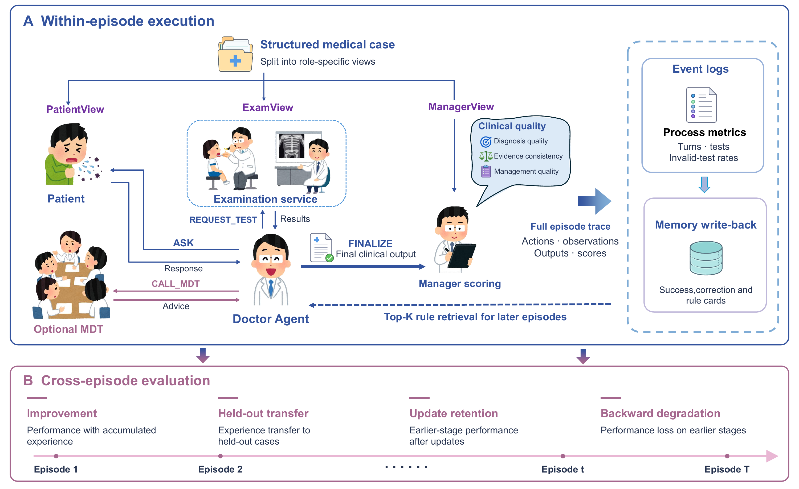

# MedEvoEval

Code and results for *MedEvoEval: Evaluating Continual Evolution of Doctor Agents through Simulated Clinical Episodes*.

[Paper](https://arxiv.org/abs/2606.28900) · [Code](https://github.com/huihuihenqiang/MedEvoEval) · [Dataset](https://www.kaggle.com/datasets/anonymousmedevoeval/medevoeval-anonymous-review-dataset) · [Project page](https://huihuihenqiang.github.io/medevoeval/)

This package provides the clinical episode engine, experiment configurations, paper result inputs, statistical analysis, and vector plotting. All published utility values use the paper formula, with turn divisor 10.

[](docs/figures/framework.pdf)

[Vector framework figure](docs/figures/framework.pdf) · [Clinical episode video](https://huihuihenqiang.github.io/medevoeval/#demo)

## Setup

For the tested statistical reproduction, use Python 3.10 and the supplied constraints. Place the two packages side by side:

```text
project/
  MedEvoEval_code/
  MedEvoEval_data/
```

Run commands from `MedEvoEval_code/`:

```console
python -m venv .venv
python -m pip install -r requirements.txt -c constraints-tested.txt
```

Activate the environment before installing dependencies. CPU execution is sufficient for the offline analysis; live inference uses the configured model API.

## Reproduce the paper tables and figures

```console
python -B scripts/verify_package.py
python -B scripts/reproduce_results.py --output-dir outputs/reproduction
```

`results/inputs/` is the analysis input directory. `results/` contains the corresponding reference tables. Reproduction writes tables to `outputs/reproduction/results/` and ten vector PDF figures with PNG previews to `outputs/reproduction/figures/`. It needs no model calls or data-package download. See [result definitions](results/README.md).

## Run the clinical engine

Check the selected configuration and load the 700 cases without making model calls:

```console
python -B scripts/run_paper.py --config configs/paper/mdt_kimi.yaml --data-dir ../MedEvoEval_data
```

Set `DASHSCOPE_API_KEY` in the environment. If required, set `DASHSCOPE_BASE_URL`. Add `--execute` to start paid provider calls:

```console
python -B scripts/run_paper.py --execute --config configs/paper/mdt_kimi.yaml --data-dir ../MedEvoEval_data --start 0 --end 99 --run-id mdt_kimi_01
python -B scripts/run_paper.py --execute --config configs/paper/strong_primary_mdt.yaml --data-dir ../MedEvoEval_data --start 0 --end 99 --run-id strong_mdt_01
```

Scenario IDs are zero-based and both endpoints are inclusive. Use a new run ID for each execution. Output is written beneath `outputs/engine/`; data files are read-only inputs. The configuration selects the paper's token profile automatically. See [model roles and settings](docs/model_roles.md).

## Build memory and run the longitudinal protocol

```console
python -B scripts/run_longitudinal.py
python -B scripts/run_longitudinal.py --execute --run-name memory_01
```

The first command prints the plan. The second runs 2,400 episodes: E0–E3 each use scenarios 0–499; H0/H3 each use 500–699. E1 starts with an empty bank; E2/E3 inherit the preceding bank; H3 starts from the post-E3 bank and continues writeback. Memory is built from the released stream. Model API responses can vary across executions.

## Offline software checks

```console
python -B scripts/validate_release.py --output-dir outputs/check_01
python -B scripts/verify_consultant_route.py
python -B scripts/verify_configuration.py
```

The controlled checks block network access and exercise five engine/adapter episodes, role routing, invalid tests and memory behavior. `scripts/run_demo.py` provides a separate small synthetic demonstration. Demonstration outputs do not enter the paper statistics.

## Files

| Directory | Contents |
|---|---|
| `medsim/` | Clinical engine, role prompts, scoring and memory |
| `configs/paper/` | Four-model, MDT and longitudinal configurations |
| `scripts/` | Running, statistics, plotting and validation |
| `results/` | Paper analysis inputs and reference results |
| `docs/` | Reproduction, fields, model roles and licenses |
| `src/medevoeval/`, `examples/` | Lightweight demonstration |

Use `--data-dir` or `MEDEVOEVAL_DATA_DIR` to select another relative data location. The default is the sibling `MedEvoEval_data/` directory. Public resource URLs are listed in `release_urls.json`.

## Physician review materials

Participant instructions and the two blank audit worksheets are in [docs/physician_review](docs/physician_review/README.md).

## License and packaging

Code and original project assets retain CC BY-NC-SA 4.0; see [LICENSE](LICENSE), [NOTICE](NOTICE.md) and [component licenses](docs/asset_licenses.md). MedQA attribution is preserved in the data package. Cite the accompanying paper when using this resource.

```console
python -B scripts/package_release.py
```

The command creates `dist/MedEvoEval_code.zip` from the verified file manifest. Local outputs, environments and credentials are excluded.
